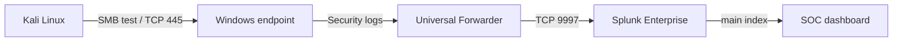
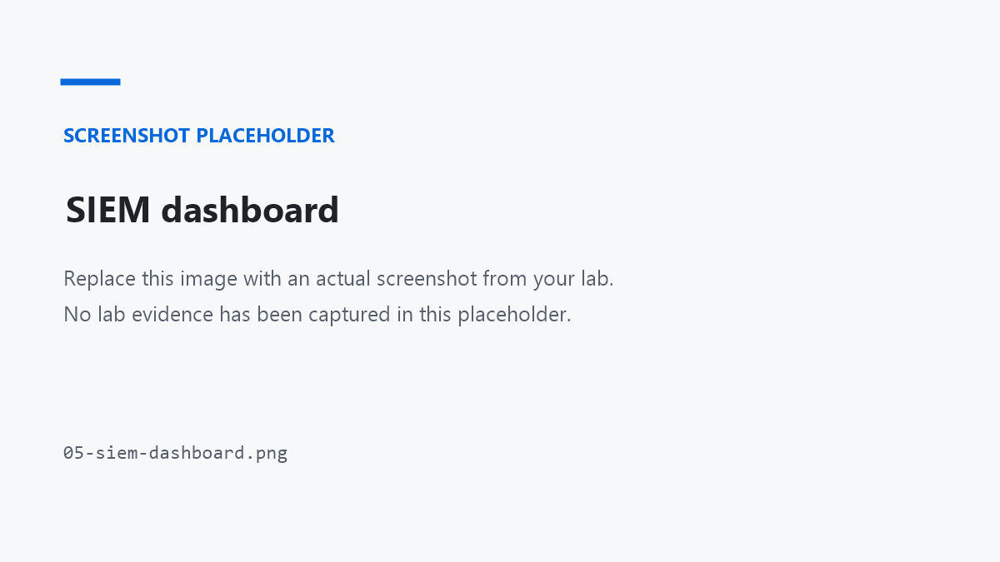

# Splunk SIEM Detection Lab

**Windows log collection, authentication analysis, and SOC dashboard monitoring.**

## Project overview

I built a Splunk lab to collect Windows Security logs, review login activity, and create a monitoring dashboard. A controlled SMB password test generated activity to investigate using the account name, event details, and source IP.

**Tools:** Splunk Enterprise, Splunk Universal Forwarder, Windows Security logs, Kali Linux, and NetExec.

## Real-world scenario

A workstation tries several passwords for an employee account and then logs in successfully. A SOC analyst needs to check who logged in, where the attempt came from, and whether the access was expected.

I reproduced this pattern in an authorized lab using the disposable account `VictimUser`.

## Lab architecture

The Windows endpoint provides the logs, the forwarder sends them, and Splunk stores and displays them.

## Implementation

1. **Configured receiving:** enabled TCP port `9997` in Splunk.
2. **Collected logs:** configured Universal Forwarder to monitor `WinEventLog://Security` and send events to the `main` index.
3. **Tested authentication:** used Kali Linux and NetExec to try passwords against the lab account over SMB.
4. **Reviewed events:** searched Windows login events in Splunk and inspected the successful login details.
5. **Built the dashboard:** added panels for failed logins over time and successful logins by account.

## Dashboard and searches

The dashboard is named **SOC - Enterprise Monitoring**. Both panels use column charts.

| Panel | Event code | What it shows |
| --- | --- | --- |
| Failed logins over time | `4625` | Changes in failed login activity. |
| Successful logins by account | `4624` | Login counts grouped by account name. |

The two searches are saved in [dashboard_queries.spl](queries/dashboard_queries.spl). Run each search separately.

## Results and evidence

| Result | Screenshot |
| --- | --- |
| Splunk receiving port `9997` is enabled. | [Receiving setup](screenshots/01-splunk-receiving.png) |
| The forwarder installer shows the receiving address and port. | [Forwarder setup](screenshots/02-forwarder-config.png) |
| The SMB test shows three failed password attempts followed by successful authentication. | [Kali test](screenshots/03-kali-attack.png) |
| A Windows login event is searchable in Splunk. | [Raw logs](screenshots/04-raw-logs.png) |
| The success event identifies `VictimUser`, source IP `10.242.185.195`, and network logon type `3`. | [Event details](screenshots/06-successful-logon-details.png) |

## MITRE ATT&CK mapping

| Tactic | Technique | Evidence in the lab |
| --- | --- | --- |
| Credential Access | [T1110.001 — Password Guessing](https://attack.mitre.org/techniques/T1110/001/) | NetExec tries several passwords for `VictimUser`; three fail before a credential succeeds. |
| Initial Access | [T1078.003 — Local Accounts](https://attack.mitre.org/techniques/T1078/003/) | The local test account authenticates successfully, and Splunk records its network login (`4624`, type `3`). |

These mappings describe an authorized simulation. Successful authentication does not establish administrator access or lateral movement. See the [mapping rationale and screenshot evidence](docs/architecture-report.md#mitre-attck-mapping).

## Skills demonstrated

- Configuring centralized log collection with Splunk and Universal Forwarder.
- Reviewing Windows login events and identifying account and source details.
- Writing SPL searches and building dashboard panels.
- Explaining a security test using original screenshot evidence.

## Repository guide

- [configs/inputs.conf](configs/inputs.conf): Windows Security log input.
- [queries/dashboard_queries.spl](queries/dashboard_queries.spl): dashboard searches.
- [docs/architecture-report.md](docs/architecture-report.md): configuration and event findings.
- [screenshots/](screenshots/): six original lab screenshots.
