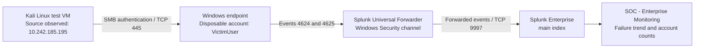

# Splunk SIEM Detection Lab

**Windows authentication monitoring | Splunk Enterprise | Universal Forwarder | SOC investigation**

This project documents a completed authentication-monitoring lab: Windows Security events were collected in Splunk while a Kali Linux VM performed a controlled SMB password-guessing exercise against the disposable account `VictimUser`.

The repository includes original screenshot evidence, the documented forwarding configuration, dashboard searches, and a real-world SOC case study explaining how an analyst would investigate repeated failed logons followed by a successful network logon.


## Results at a glance

| Observation | Supporting evidence |
| --- | --- |
| Splunk receiving port `9997` is enabled. | [Receiving configuration](screenshots/01-splunk-receiving.png) |
| The forwarder installer specifies receiver `10.242.185.132:9997`. | [Forwarder setup](screenshots/02-forwarder-config.png) |
| The SMB test shows three rejected passwords followed by an accepted credential for `VictimUser`. | [Kali test output](screenshots/03-kali-attack.png) |
| A search across events `4624` and `4625` returns **1,889 events** for the displayed November 2026 range. | [Splunk search and raw event](screenshots/04-raw-logs.png) |
| The expanded success event identifies `VictimUser`, logon type `3`, and source address `10.242.185.195`. | [Successful network-logon details](screenshots/06-successful-logon-details.png) |
| The saved **SOC - Enterprise Monitoring** dashboard contains a failure timechart and successful-logon counts by account, both displayed as column charts. | [Final dashboard](screenshots/05-siem-dashboard.png) |

The 1,889 results include background activity over the selected range; they are not the number of password guesses in the controlled test.

## Real-world scenario

An internal workstation makes repeated SMB authentication attempts against a Windows endpoint. Several passwords fail for the same account, then a network logon succeeds. In a business environment, that pattern could indicate credential guessing followed by account access and would justify checking the source asset, account owner, and subsequent activity.

This lab reproduces the authentication pattern in an authorized test environment. Read the [SOC investigation and response case study](docs/real-world-scenario.md) for the evidence timeline, ATT&CK mapping, investigation steps, false positives, and proposed correlation search.

## Architecture



These are functional roles. The forwarder screenshot and the SMB test both show `10.242.185.132` as a destination; the screenshots do not establish distinct addresses for the SIEM server and Windows endpoint. The [architecture report](docs/architecture-report.md) records the captured values and topology limitations.

## Configuration and reproduction

The input configuration supplied with the lab walkthrough is saved in [configs/inputs.conf](configs/inputs.conf):

```ini
[WinEventLog://Security]
disabled = 0
index = main
```

[configs/outputs.conf](configs/outputs.conf) records the receiver shown during forwarder setup. These files document the supplied settings; they are not exports taken from the running hosts.

To reproduce the collection path in your own lab:

1. Enable a Splunk receiving input on TCP `9997` and allow the authorized endpoint to reach it.
2. Install Universal Forwarder on the Windows endpoint and configure the actual receiver address.
3. Add the input stanza to the forwarder's `etc/system/local/inputs.conf`, preserve any existing required stanzas, and restart the forwarder after applying changes.
4. Confirm that Windows Audit Logon records the relevant success and failure activity.
5. Generate authentication activity with an authorized, disposable test account, then search the interval containing the test.
6. Build the two panels below, or import the supplied dashboard recreation.

For the archived screenshots, select a range covering **November 2026**. A relative time picker used much later may not include these events.

### Dashboard searches

Run each block separately. The searches follow the supplied walkthrough; the original dashboard source was not exported.

**Failed logons over time — column chart**

```spl
index=main EventCode=4625
| timechart count
```

**Successful logons by account — column chart**

```spl
index=main EventCode=4624
| stats count by Account_Name
```

Both searches are saved in [queries/dashboard_queries.spl](queries/dashboard_queries.spl). For investigations, distinguish the Windows event's target account from its subject account. The [authentication timeline search](queries/authentication_timeline.spl) includes target-account extraction for the supplied text-event format.

### Recreate the dashboard

[dashboards/soc-enterprise-monitoring.xml](dashboards/soc-enterprise-monitoring.xml) provides a Classic Simple XML recreation with two column charts and a shared time picker. Create a Classic dashboard in Splunk, open its source editor, paste the XML, and select the period containing your data.

The XML and additional investigation searches were prepared for this repository and have not been executed on the lab instance. The screenshot above is the owner's actual saved dashboard.

## Screenshot evidence

| File | What it shows |
| --- | --- |
| [01-splunk-receiving.png](screenshots/01-splunk-receiving.png) | Receiving port `9997` enabled. |
| [02-forwarder-config.png](screenshots/02-forwarder-config.png) | Receiver entered in Universal Forwarder setup. |
| [03-kali-attack.png](screenshots/03-kali-attack.png) | Controlled SMB password-guessing results. |
| [04-raw-logs.png](screenshots/04-raw-logs.png) | Search results and the beginning of a successful-logon event. |
| [05-siem-dashboard.png](screenshots/05-siem-dashboard.png) | Completed SOC dashboard. |
| [06-successful-logon-details.png](screenshots/06-successful-logon-details.png) | Account, logon type, and source address in the expanded event. |

The [evidence register](docs/evidence-register.md) includes all six images, their hashes, and the scope of each observation. Eight images were supplied; three were identical copies of the same log-detail capture, stored here once. The terminal screenshot is preserved unchanged with a disposable lab password, as confirmed by the owner.

## Repository layout

```text
Splunk-SIEM-Detection-Lab/
├── README.md
├── configs/
│   ├── inputs.conf
│   └── outputs.conf
├── dashboards/
│   └── soc-enterprise-monitoring.xml
├── queries/
│   ├── dashboard_queries.spl
│   ├── authentication_timeline.spl
│   └── failed_then_success.spl
├── screenshots/
│   ├── 01-splunk-receiving.png
│   ├── 02-forwarder-config.png
│   ├── 03-kali-attack.png
│   ├── 04-raw-logs.png
│   ├── 05-siem-dashboard.png
│   └── 06-successful-logon-details.png
└── docs/
    ├── architecture-report.md
    ├── real-world-scenario.md
    └── evidence-register.md
```

## Skills demonstrated

- Centralized Windows event collection and forwarder configuration.
- Authentication-event analysis and source-address investigation.
- SPL searches, timecharts, and account-based aggregation.
- Dashboard construction and evidence-based SOC reporting.
- Translating a controlled password-guessing exercise into an analyst investigation.

## Documentation

- [Architecture, configuration, and technical references](docs/architecture-report.md)
- [Real-world SOC investigation scenario](docs/real-world-scenario.md)
- [Screenshot evidence and provenance](docs/evidence-register.md)
