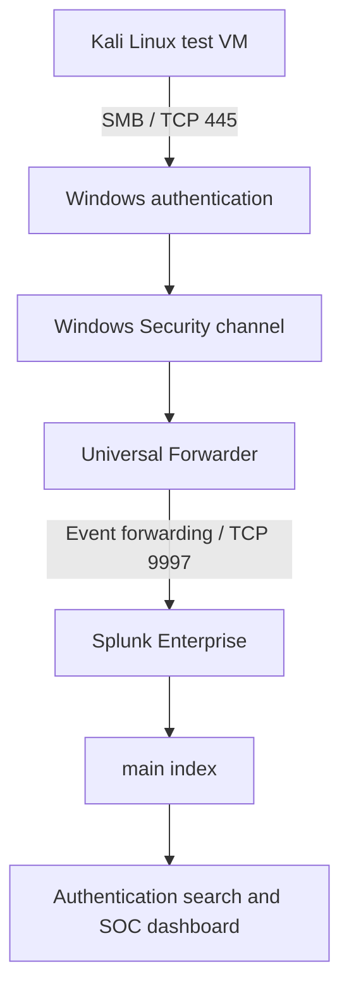

# Architecture and Configuration Report

## Objective and scope

The lab demonstrates a Windows authentication telemetry pipeline using Splunk Enterprise and Universal Forwarder, supported by a controlled SMB password-guessing exercise from Kali Linux. Its purpose is to collect security events centrally, visualize authentication patterns, and practice SOC investigation.

The owner supplied a completed-lab walkthrough and screenshots. This report documents those materials. Configuration files transcribe or reconstruct the supplied settings; the original hosts and dashboard source were not accessed during preparation of this repository update.

## Components

| Component | Role | Evidence |
| --- | --- | --- |
| Splunk Enterprise | Receives events, searches the `main` index, and displays the dashboard. | Receiving, search, and dashboard screenshots. |
| Windows endpoint | Hosts disposable account `VictimUser` and produces Security events. | SMB test output and expanded Windows event. |
| Universal Forwarder | Collects Windows Security events and forwards them to the receiver. | Installer screenshot and supplied configuration walkthrough. |
| Kali Linux VM | Generates the authorized SMB authentication test. | Original terminal screenshot. |

The guide describes a Windows SIEM server and Windows client. The screenshots establish the applications and event content, but do not independently confirm each operating-system edition or whether the SIEM and endpoint occupy separate machines.

## Network flow and captured addresses



| Captured value | Interpretation |
| --- | --- |
| `9997`, status enabled | Configured Splunk receiving input. |
| `10.242.185.132:9997` | Receiver entered in the Universal Forwarder installer. |
| `10.242.185.132:445` | SMB destination in the Kali test output. |
| `10.242.185.195` | Source address in the expanded successful-logon event, attributed to the test VM in the supplied scenario. |
| `46920` | Source port in that network-logon event. |

The receiving destination and SMB target share `10.242.185.132` in the captures. A separate receiver/endpoint address pair cannot be reconstructed from these images. The guide's example `192.168.1.x` addresses are illustrative and are not measured lab values.

Enabling a Splunk receiving input establishes an application listener. The receiving screenshot alone does not establish a Windows Firewall rule, TLS configuration, or network-isolation policy.

## Windows event collection

The documented input configuration is:

```ini
[WinEventLog://Security]
disabled = 0
index = main
```

Repository file: [configs/inputs.conf](../configs/inputs.conf).

The guide places this stanza in `C:\Program Files\SplunkUniversalForwarder\etc\system\local\inputs.conf` and restarts `SplunkForwarder`. No screenshot of the file or effective runtime configuration was supplied; the repository file transcribes the owner's guide.

Splunk documents collection through `WinEventLog` input stanzas. The forwarder service account needs access to the Security channel, and Windows audit policy must generate the events. [Splunk: monitor Windows event log data](https://help.splunk.com/en/splunk-enterprise/get-started/get-data-in/9.4/get-windows-data/monitor-windows-event-log-data-with-splunk-enterprise), [Microsoft: Audit Logon](https://learn.microsoft.com/windows/security/threat-protection/auditing/audit-logon).

[configs/outputs.conf](../configs/outputs.conf) reconstructs a minimal target from the installer screenshot. It is not a live configuration export and does not establish TLS settings.

## Authentication telemetry

| Field | Observed or documented meaning |
| --- | --- |
| `EventCode=4624` | Successful logon; an expanded example is visible in Splunk. |
| `EventCode=4625` | Failed logon; included in the search and failure-chart query. |
| `Logon Type: 3` | Network logon, as shown in the success event. |
| `New Logon / Account Name: VictimUser` | Target account in that event. |
| `Source Network Address: 10.242.185.195` | Remote address recorded in that event. |
| `RecordNumber=92368` | Links the raw-event overview to its expanded details. |

Microsoft documents `4624` as a successful logon, `4625` as a failed logon, and type `3` as network access. A successful network logon does not establish share access or administrator privileges. [Microsoft: event 4624](https://learn.microsoft.com/windows/security/threat-protection/auditing/event-4624), [Microsoft: event 4625](https://learn.microsoft.com/windows/security/threat-protection/auditing/event-4625).

## Searches and dashboard

The search screenshot uses:

```spl
index=main EventCode=4625 OR EventCode=4624
```

It shows 1,889 matches over the displayed November 2026 range, including background activity. The expanded record is a success event. This total cannot be treated as the controlled exercise's attempt count.

| Panel | Search from the guide | Captured visualization |
| --- | --- | --- |
| Failed logons over time | `index=main EventCode=4625 \| timechart count` | Column chart. |
| Successful logons by account | `index=main EventCode=4624 \| stats count by Account_Name` | Column chart. |

The saved dashboard is named **SOC - Enterprise Monitoring**. Its lower panel is a chart, although the guide suggests a table. This report follows the screenshot.

[The dashboard XML](../dashboards/soc-enterprise-monitoring.xml) recreates the two panels using the guide's searches and a shared time picker. It was prepared for import and has not been tested on the instance. Splunk's [Simple XML reference](https://help.splunk.com/en/splunk-enterprise/create-dashboards-and-reports/simple-xml-dashboards/9.2/simple-xml-reference/simple-xml-reference) describes the form, chart, search, and input elements.

Copy each dashboard query separately. Inline annotations use [Splunk's triple-backtick comment syntax](https://help.splunk.com/en/splunk-enterprise/search/search-manual/10.4/use-the-search-app/add-comments-to-searches).

## Validation and limits

- The receiver, installer target, terminal authentication sequence, indexed success event, and dashboard are visible in the original evidence.
- The terminal shows three `STATUS_LOGON_FAILURE` results followed by success. The expanded success event identifies the test account and a remote source.
- Raw `4625` details with matching source, account, and timestamps were not supplied. Exact event-by-event correlation remains an investigation step.
- Ingestion latency, delivery completeness, automatic alerting, TLS, and response actions were not measured or demonstrated.
- The timeline and failed-then-success searches are proposed investigation material, not lab-tested results.
- Their text extraction targets the supplied English event format. XML events, localization, or different add-ons require field validation.

## Production improvements

These are recommendations for a future deployment:

1. Configure authenticated TLS for forwarding and validate certificate trust.
2. Use a dedicated security index with suitable retention and access controls.
3. Scope receiver and SMB connectivity to authorized hosts; monitor missing telemetry.
4. Verify auditing, clock synchronization, and target-account/source-address extraction.
5. Tune alert thresholds against expected service-account and user activity.
6. Add share-access and endpoint telemetry to investigate activity after authentication.

See the [SOC scenario](real-world-scenario.md) for the investigation and the [evidence register](evidence-register.md) for original captures and hashes.
