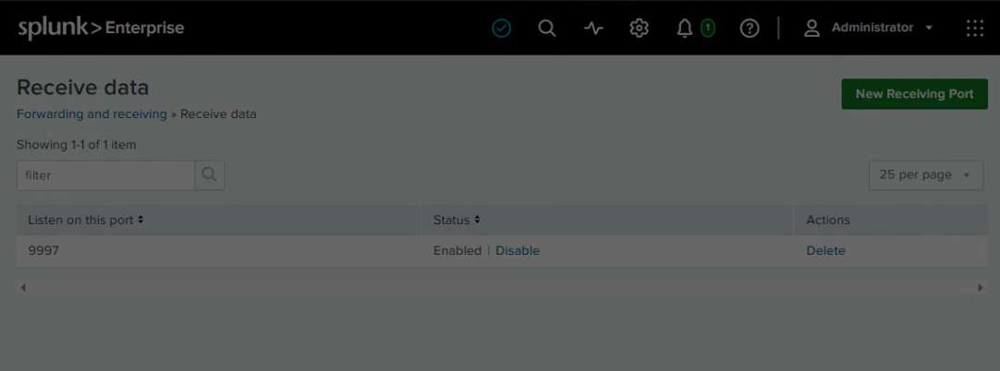
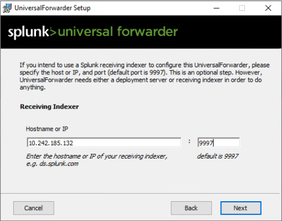
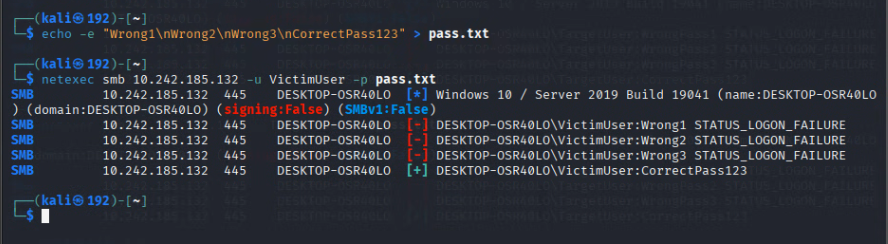
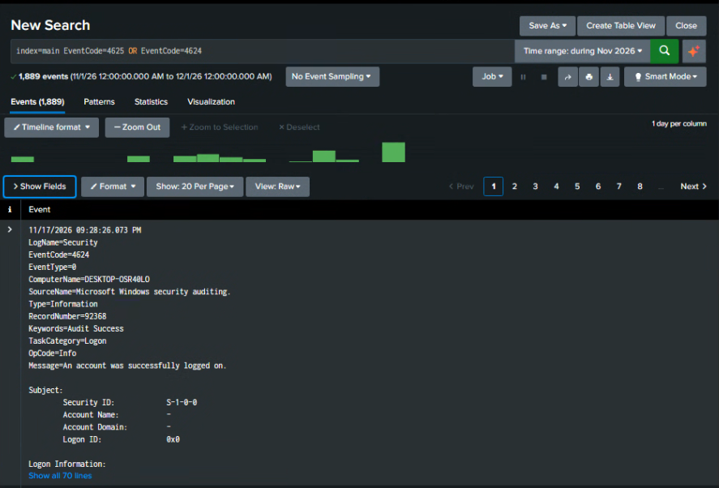
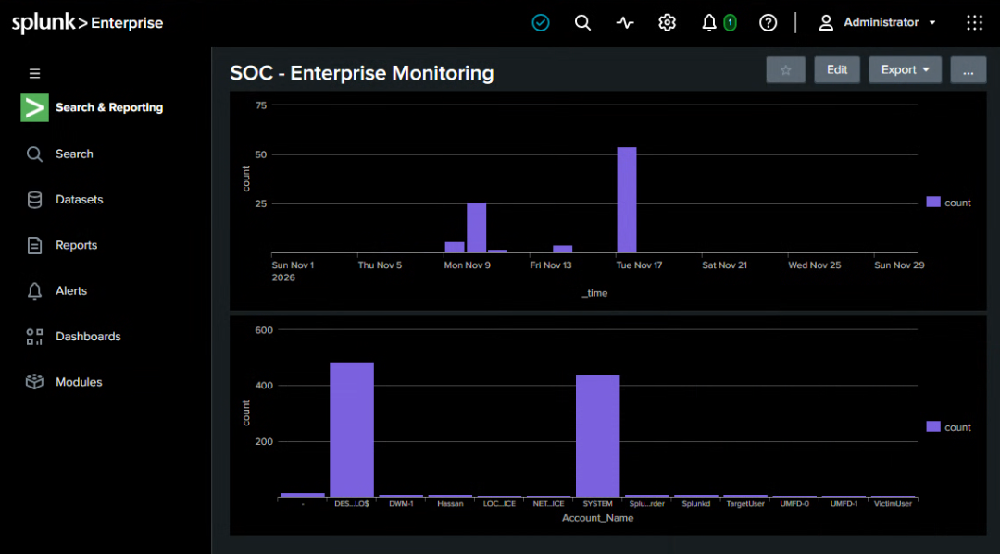
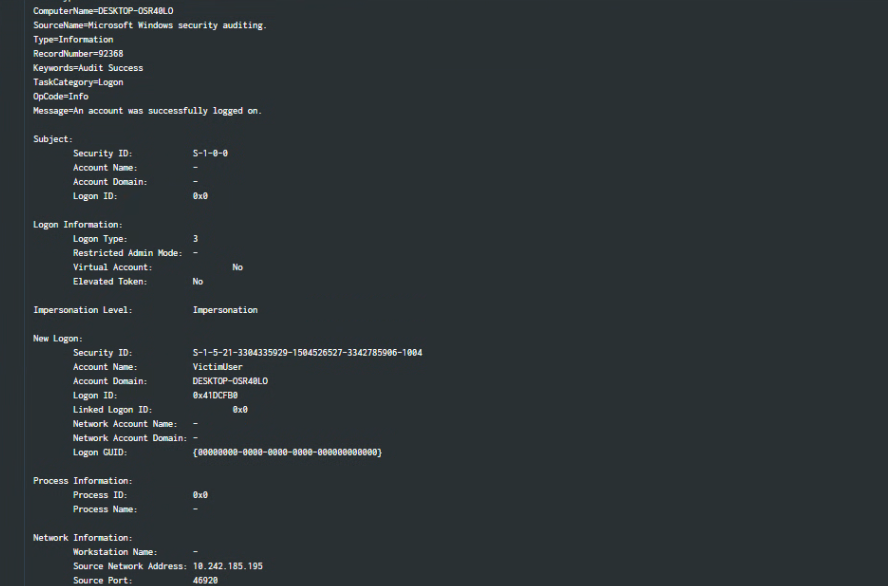

# Screenshot Evidence Register

The owner supplied eight PNG attachments representing six distinct screenshots. Attachments 5, 6, and 7 are byte-identical copies of the same expanded log detail and are stored once as `06-successful-logon-details.png`. The two supplied walkthrough text files were also identical and were reconciled into the project documentation.

Every image below is an unchanged copy of an owner-supplied screenshot. No image enhancement, redaction, generated interface, or reconstructed screenshot has been applied. SHA-256 values verify that the repository copies match the supplied files; they do not independently verify the original capture process.

The configuration and reproduction searches are documented separately. No screenshot of `inputs.conf`, raw failure-event detail, or executed correlation-search result was supplied.

## 01. Splunk receiving input

The receiving page shows TCP port `9997` with status enabled. This establishes an application input setting.

## 02. Universal Forwarder setup

The receiving-indexer field contains `10.242.185.132` and port `9997`. This is the captured installer setting.

## 03. Controlled SMB authentication exercise

The terminal shows three rejected password candidates and then an accepted credential for `VictimUser`. The owner confirmed the visible password is disposable lab data and requested that the original image be retained.

## 04. Search results and raw success event

The search includes event codes `4624` and `4625`, with 1,889 results over the displayed November 2026 range. The visible expanded entry is `4624`, record `92368`; the aggregate includes background activity.

## 05. SOC - Enterprise Monitoring dashboard

The saved dashboard displays a time-based authentication chart above an account-count chart. Both panels are column charts. Their reproduction searches come from the supplied guide because no original dashboard XML was provided.

## 06. Expanded network-logon context

The continuation of record `92368` shows target account `VictimUser`, logon type `3`, source network address `10.242.185.195`, and source port `46920`. It supplies the account and network context for the successful event.

## File integrity

| File | SHA-256 |
| --- | --- |
| [01-splunk-receiving.png](../screenshots/01-splunk-receiving.png) | `3c2bb4b3bb4f8feffd1de0a3ff5abe7ea95b7ef066831ffd4fc1ef3849026437` |
| [02-forwarder-config.png](../screenshots/02-forwarder-config.png) | `8165e807e46c54fba9decc502ce1b1b7bfa243135e6165b2d446e041b145fddc` |
| [03-kali-attack.png](../screenshots/03-kali-attack.png) | `6fa31a37704b3d8b4d47428805e589d0e1d8b8bdbe8a958b023c8c46e702118e` |
| [04-raw-logs.png](../screenshots/04-raw-logs.png) | `ae39a5c85a6e03e891ca8ec427c0295814b1ea94c77b42fec7e2544f12f3256f` |
| [05-siem-dashboard.png](../screenshots/05-siem-dashboard.png) | `29eccee53410395964a16fc0fc3a4b9b1a41227f7c3e60387573098c5f535680` |
| [06-successful-logon-details.png](../screenshots/06-successful-logon-details.png) | `6b2a4802aed2abb2b4742693f339f90fa5cb8f8e3cf2aa8db4abb5d0eb0f30ec` |

See the [architecture report](architecture-report.md) for configuration provenance and the [SOC scenario](real-world-scenario.md) for interpretation and investigation limits.
